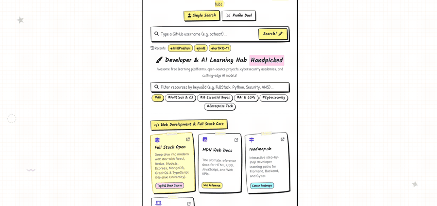

# 🎨 Gitfind — Hand-Drawn GitHub User Finder & Developer Hub

[](https://vuejs.org/)
[](https://nodejs.org/)
[](https://expressjs.com/)
[](https://aws.amazon.com/amplify/)
[](LICENSE)

[](https://github.com/JimilPrabtani/Github-finder/actions/workflows/codeql.yml)
[](https://github.com/JimilPrabtani/Github-finder/actions/workflows/zap.yml)

> Search GitHub profiles, battle developers head-to-head, export hand-drawn
> profile badges — and explore a curated hub of learning resources that
> actually helped me grow. Built with **Vue 3 (Vite)** and a **Node.js Express
> API proxy**, secured end-to-end with free and open-source tooling.



---

## 💡 Why I Built This

Finding good learning resources on the internet is genuinely hard. Search
results are flooded with low-effort listicles, outdated tutorials, and courses
that exist to sell you something — it's easy to get confused, hop between ten
tabs, and waste hours without actually learning. GitHub has the same problem
in a different shape: millions of profiles and repositories, but no quick way
to *understand* a developer at a glance — what they build, what languages
they live in, how active they really are.

Gitfind is my answer to both problems in one app:

- **The Resource Hub is not scraped or auto-generated.** Every entry — 55+
  developer tools, AI platforms (Hugging Face, Ollama, Gemini), cybersecurity
  academies (PortSwigger, TryHackMe), enterprise learning hubs (AWS, Azure,
  CrowdStrike, Palo Alto), and 16 essential GitHub repos — is something I
  personally used and that genuinely helped me learn and grow in my career.
  It's the curated list I wish I had when I started.
- **The profile tools** (search, language breakdown, activity stats, duel
  mode) turn a raw GitHub profile into something readable in seconds.

And because I'm building a career in cybersecurity, I treated the project
itself as practice: the entire app is secured layer-by-layer using **free and
open-source security tools**, documented below.

---

## ✨ Features

- 🎨 **Hand-Drawn Sketchbook Aesthetic**: Wobbly asymmetric borders, paper graph background grid, marker highlighter overlays, masking tape accents, and handwritten Google Fonts (`Caveat`, `Kalam`, `Patrick Hand`).
- 🌙 **Dark Notebook / Light Sketch Theme**: Seamless toggle between warm paper (`#fcfaf2`) and dark slate notebook paper (`#12151e`) with `localStorage` memory.
- 🔍 **Single User Profile Search**: Avatars, bio, location, join date, followers/following/repo counts — with proper loading, error, and empty states.
- 📊 **Language Breakdown & Persona Assignment**: Language distribution bar charts and auto-assigned developer personas (*"🐍 Python Alchemist"*, *"⚡ JS/TS Web Wizard"*, *"⚙️ Systems Architect"*, etc.).
- 📈 **Contribution & Activity Metrics**: Account age, public gists, and activity levels (*"⚡ Hyper-Active Contributor"*).
- ⚔️ **Profile Duel Mode**: Head-to-head battle comparing two GitHub users with dynamic score calculations and a winner trophy banner.
- 📸 **Export Profile Badge as Image (`html2canvas`)**: One-click download of hand-drawn profile badges as crisp PNG files.
- 🏷️ **Developer & AI Learning Hub**: Live keyword search and category tag filtering across the curated resource collection.
- ⭐ **Bookmarks & Recent Searches**: Save favorite profiles to a modal drawer and quickly re-search recent lookups.

---

## 🔒 Security Architecture — Defense in Depth

Security here isn't one tool — it's independent layers, each catching what the
previous one misses. Everything below is **free and/or open source**.

```
        ┌─────────────────────────────────────────────┐
        │             Visitor's Browser                │
        │   CSP + security headers enforced here       │
        └──────────────────────┬──────────────────────┘
                               │ HTTPS
        ┌──────────────────────▼──────────────────────┐
        │   AWS WAF  →  AWS Amplify Hosting (CDN)      │
        │   edge rate limiting · managed rules         │
        │   custom security headers (amplify.yml)      │
        │   account activity logged via CloudTrail     │
        └──────────────────────┬──────────────────────┘
                               │  fetch("/api/…")
        ┌──────────────────────▼──────────────────────┐
        │        Node.js + Express API Proxy           │
        │   Zen RASP firewall (runtime protection)     │
        │   Helmet · CORS allowlist · rate limiting    │
        │   username regex validation · response       │
        │   field allow-listing · PAT stays server-side│
        └──────────────────────┬──────────────────────┘
                               │  Authorization: token ghp_***
        ┌──────────────────────▼──────────────────────┐
        │             GitHub REST API v3               │
        └─────────────────────────────────────────────┘
```

| Layer | Tool / Technique | What it defends against |
|---|---|---|
| **Application code** | Strict username regex validation, response field allow-listing, no HTML injection sinks (no `v-html`), GitHub PAT kept server-side only | Injection at the source, token theft, data over-exposure |
| **HTTP middleware** | Helmet, CORS origin allowlist, `express-rate-limit` (30 req/min/IP) | Header-based attacks, cross-origin abuse, endpoint hammering |
| **Browser policy** | Content-Security-Policy, `X-Frame-Options`, HSTS, `nosniff` — served via Amplify `customHeaders` | XSS execution, clickjacking, protocol downgrade |
| **Network edge** | **AWS WAF** with rate limiting in front of Amplify Hosting | Bots, floods, and common exploit patterns before they reach the app |
| **Runtime (RASP)** | **[Zen by Aikido](https://github.com/AikidoSec/firewall-node)** — open-source in-app firewall instrumenting the Express process | Injection/SSRF attempts at the moment of execution, live attack telemetry |
| **SAST (pipeline)** | **CodeQL** in GitHub Actions on every push/PR — taint-tracking analysis across the JS/Vue codebase | Vulnerable code patterns caught before they deploy |
| **DAST (pipeline)** | **OWASP ZAP** baseline scan in GitHub Actions — builds the app in CI and crawls it with an AJAX spider | Missing headers, misconfigurations, runtime-visible flaws |
| **Supply chain** | `npm audit`, Dependabot, GitHub secret scanning with push protection | Known-vulnerable dependencies, leaked credentials |
| **Audit trail** | **AWS CloudTrail** logging account activity | Unnoticed infrastructure changes, forensic blind spots |

**What I deliberately did *not* add** — security should match the threat
model, not a checklist: no authentication system (there are no user accounts),
no secrets manager (two environment variables don't justify one), no SIEM or
container scanning (nothing to feed them). Knowing when to stop adding tools
is part of the discipline.

See [SECURITY.md](SECURITY.md) for the vulnerability disclosure policy.

---

## 🛠️ Tech Stack

- **Frontend Framework**: Vue 3 (Composition API `<script setup>`), Pinia (State Management), Vue Router
- **Build Tool**: Vite 6
- **Styling**: Vanilla CSS3 Custom Properties (CSS Tokens, Hand-Drawn Wobbly Radius, Dynamic Theme Attributes)
- **Backend API Proxy**: Node.js, Express.js
- **Security**: Helmet, CORS, express-rate-limit, Zen RASP, AWS WAF, CodeQL, OWASP ZAP
- **Deployment**: AWS Amplify Hosting with AWS WAF enabled and monitoring via AWS CloudTrail — CI with GitHub Actions

---

## 🚀 Quick Start (Local Setup)

### Prerequisites
- **Node.js**: v18 or higher
- **npm**: v9 or higher

### 1. Clone the Repository
```bash
git clone https://github.com/JimilPrabtani/Github-finder.git
cd Github-finder
```

### 2. Setup & Start Backend Server
```bash
cd server
npm install

# Copy the env template, then fill in your values
cp .env.example .env
# (Optional) GITHUB_PAT — a Classic token, read:user scope → 5,000 req/hr
# (Optional) AIKIDO_TOKEN — enables Zen runtime firewall reporting

node index.js
```
*Backend runs on `http://localhost:3001`*

### 3. Setup & Start Frontend
Open a new terminal window in the project root:
```bash
npm install
npm run dev
```
*Frontend runs on `http://localhost:5173`*

> **Note:** the frontend works even without the backend — it falls back to
> calling the GitHub API directly (60 req/hr, unauthenticated). Running the
> proxy adds the higher rate limit and keeps the PAT off the client entirely.

---

## ☁️ Deployment to AWS Amplify

This project includes a pre-configured [`amplify.yml`](amplify.yml) build spec —
including the security headers — ready for **AWS Amplify Hosting**.

1. Generate a **GitHub Classic Token** (`read:user` scope) at [github.com/settings/tokens](https://github.com/settings/tokens).
2. Push your code to GitHub.
3. Open **AWS Amplify Console** → **New App** → **Host Web App**.
4. Connect your GitHub repository branch (`master`).
5. Under **Environment Variables**, add `GITHUB_PAT` = `ghp_your_token_here`.
6. Click **Save and Deploy**.
7. (Recommended) Attach **AWS WAF** to the app for edge protection, and keep
   **CloudTrail** enabled for account activity logging.

---

## 🤝 Contributing

Contributions, issues, and feature requests are welcome! Check the [issues page](https://github.com/JimilPrabtani/Github-finder/issues) and see [CONTRIBUTING.md](CONTRIBUTING.md) for submission guidelines. Every push and pull request is automatically scanned by CodeQL and ZAP.

---

## 📄 License

Distributed under the **MIT License**. See [LICENSE](LICENSE) for details.

---

## 👨‍💻 Author

Developed with ❤️ by **Jimil Prabtani**
- **GitHub**: [@JimilPrabtani](https://github.com/JimilPrabtani)
- **Repository**: [github.com/JimilPrabtani/Github-finder](https://github.com/JimilPrabtani/Github-finder)
